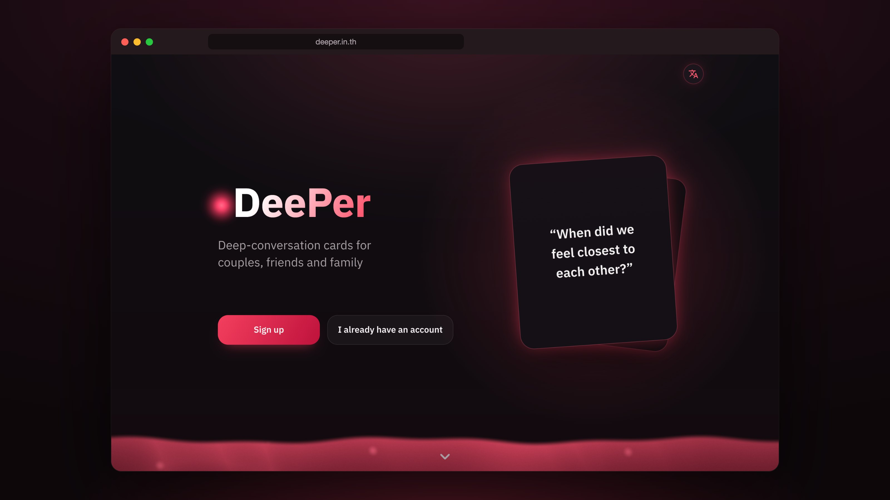
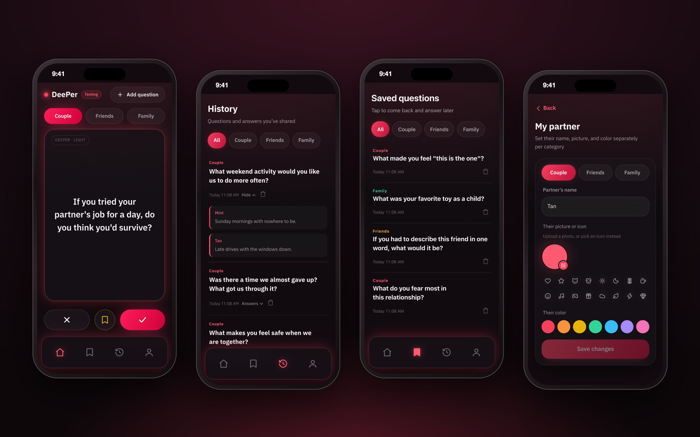
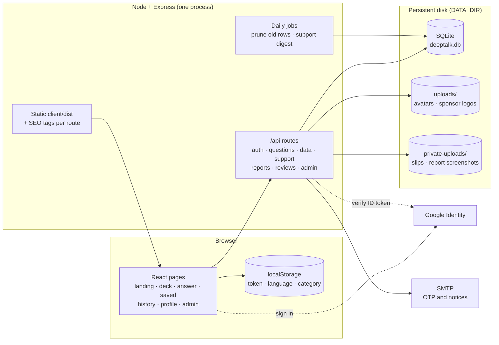
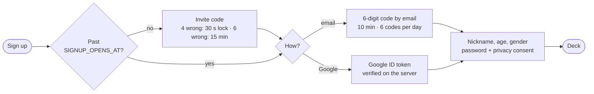

<div align="center">


# DeePer

### Talk deeper, one question at a time.

Question cards for couples, friends and family who share one phone.<br />
Swipe to a question, answer it in turns, and keep every answer to read again later.

<p>
  
  
  
  
  
  
</p>



</div>

<br />

## Why DeePer

"Have you eaten?" "How was your day?" "Home yet?" Most of what people we love hear from us is the same few questions. DeePer gives two people something better to ask. Open it on one phone, pick who you're talking with and how deep to go, and pass the phone back and forth. Nobody else needs to download anything.

<table>
  <tr>
    <td width="33%" valign="top"><h4>1,050 questions</h4>Couple, friends and family, each in three levels from easy openers to deep ones, all in Thai and English. The deck can start light and get deeper as you play.</td>
    <td width="33%" valign="top"><h4>Swipe, then take turns</h4>Swipe right to answer, left to skip, or save a card for later. You type your answer, then hand the phone over for theirs.</td>
    <td width="33%" valign="top"><h4>A partner per circle</h4>Give your partner, your friend and your family their own name, photo or icon, and colour. Each category remembers who you're talking with.</td>
  </tr>
  <tr>
    <td valign="top"><h4>Your own questions</h4>Add a question to any category and it joins the deck with an "ours" label.</td>
    <td valign="top"><h4>History and memories</h4>Every answer is kept, newest first. Now and then the app brings back a question you talked about before.</td>
    <td valign="top"><h4>Share a card</h4>Turn any question into an image sized for an IG Story or LINE in a few seconds.</td>
  </tr>
</table>

<br />

## A look around


<p align="center"><sub><b>Deck, History, Saved and My partner.</b> Built for one phone held between two people.</sub></p>

<br />

## Architecture

DeePer is one Node process. Express serves the JSON API under `/api` and the built React app from `client/dist`, so a deploy is a single web service with a disk. SQLite runs through Node's built-in `node:sqlite`, so there is nothing native to compile.



### Signing up before and after launch

Until `SIGNUP_OPENS_AT` (11/11/2569 11:11 Bangkok time by default), signing up needs a six-digit invite code. After that anyone can sign up, with no deploy needed. Logging in to an existing account is never gated.



The same message comes back whether or not an email already has an account; people who do get a notice by email instead of a code.

<br />

## Getting started

Needs **Node.js 22 or newer** (24 is what production runs) for `node:sqlite`.

```bash
npm run install:all     # server + client dependencies
npm run dev:server      # API on http://localhost:4000
npm run dev:client      # app on http://localhost:5173  ← open this
```

Vite proxies `/api` and `/uploads` to port 4000. Nothing else is needed: without SMTP the OTP is printed in the server console and shown on screen in development, and without `GOOGLE_CLIENT_ID` the Google button is turned off. Before launch you also need `INVITE_CODE` in `server/.env` to sign up, or set `SIGNUP_OPENS_AT` to a past date.

```bash
npm --prefix server test    # server tests (node:test)
npm run build               # client → client/dist
npm start                   # production: API + app on one port
```

<br />

## Project structure

```
server/
├─ src/
│  ├─ index.js            entry: listen, daily pruning, graceful shutdown
│  ├─ app.js              Express app, helmet, CORS, static client + SEO
│  ├─ db.js               schema, migrations, question bank sync, pruning
│  ├─ questions/          couple.js · friends.js · family.js   ([Thai, English] pairs per level)
│  ├─ routes/             auth · questions · data · support · reports · reviews
│  │                      inquiries · testers · visits · clientErrors · admin
│  ├─ auth.js             JWT sessions, bcrypt, admin sign-in
│  ├─ signupGate.js       invite code until launch
│  ├─ mailer.js           OTP and notice emails (console fallback)
│  └─ *-proof(s).js, list-reports.js, send-digest.js    admin CLI scripts
└─ test/                  node:test suites

client/
├─ public/                icons, manifest (PWA), robots.txt, llms.txt
└─ src/
   ├─ pages/              Welcome, Signup, Login, Home (deck), Answer, Saved, History,
   │                      Profile and its settings pages, Support, Awards, Admin…
   ├─ components/         BottomNav, OtpInput, OnboardingTour, DeepWater, Countdown…
   ├─ store/              auth, i18n, tutorial contexts
   ├─ utils/              share card, image shrink, memories, password rules…
   ├─ i18n.js             every Thai and English string
   └─ styles.css          the design system (dark, red glow)

render.yaml              Render Blueprint: one web service + persistent disk
```

<br />

## Tech stack

| Area | Choice |
|---|---|
| Client | React 18, Vite 5, React Router 6 |
| Motion | Framer Motion, Lenis smooth scroll |
| Icons | lucide-react |
| Server | Node.js 24, Express 4, helmet, express-rate-limit |
| Database | SQLite through `node:sqlite` |
| Auth | JWT + bcryptjs, email OTP, Google Identity (`google-auth-library`) |
| Email | Nodemailer |
| Uploads | Multer, with image type checks and a low-disk guard |
| Tests | `node:test` |
| Hosting | Render (Singapore), starter plan with a 1 GB disk |

<br />

## Configuration

<details>
<summary><b>Environment variables</b></summary>

<br />

Put these in `server/.env` locally, or in the host's environment. Only `JWT_SECRET` is required in production; the server refuses to start with the default when `NODE_ENV=production`.

| Variable | What it does |
|---|---|
| `NODE_ENV` | `production` on deploy. Enforces a real `JWT_SECRET` and never returns OTP codes in responses. |
| `JWT_SECRET` | Signs session tokens. |
| `PORT` | Server port, default 4000. |
| `DATA_DIR` | Where the database and uploads live. On Render this is the disk at `/var/data`. |
| `TRUST_PROXY` | `true` behind a reverse proxy, so rate limits see each visitor's IP instead of the proxy's. |
| `CORS_ORIGIN` | Comma-separated origins allowed to call the API. |
| `APP_URL` | Public origin used in links inside emails. Falls back to `RENDER_EXTERNAL_URL`. |
| `GOOGLE_CLIENT_ID` | Turns on Google sign-in. Add your origins under "Authorized JavaScript origins". |
| `SMTP_HOST` `SMTP_PORT` `SMTP_SECURE` `SMTP_USER` `SMTP_PASS` `SMTP_FROM` `SMTP_REPLY_TO` | Real email for codes and notices. |
| `INVITE_CODE` | The six-digit code testers type before launch. Unset means nobody can sign up before launch. |
| `SIGNUP_OPENS_AT` | When signups open to everyone (ISO date). Defaults to the launch. |
| `ADMIN_EMAIL` `ADMIN_PASSWORD_HASH` | Admin sign-in for `/admin`. Kept out of the database and the repo. |
| `REPORTS_TO` `SUPPORT_DIGEST_TO` `SUPPORT_DIGEST_DAYS` | Where bug reports and the support-slip digest are emailed, and how often. |

Make the admin password hash with:

```bash
node -e "console.log(require('bcryptjs').hashSync(process.argv[1], 10))" '<password>'
```

</details>

<details>
<summary><b>Deploying on Render</b></summary>

<br />

`render.yaml` describes the service: a Node web service in Singapore with a 1 GB disk mounted at `/var/data`, health check at `/api/health`, and the build installing both halves and building the client. Values marked `sync: false` are set in the dashboard. Render backs up the disk daily.

`/api/health` touches the database and reports `disk_low` when the disk is nearly full; uploads are refused before it fills. On a deploy the server stops taking new connections and closes the database cleanly.

</details>

<details>
<summary><b>Admin and support</b></summary>

<br />

`/admin` covers visitor and usage stats, bug reports (with screenshots and email replies), support slips (approve, reject or revoke), sponsor inquiries and the sponsor list, tester requests (sending the invite code by email), review moderation and client error logs. Admin tokens last four hours, and five wrong admin passwords lock admin sign-in for 15 minutes.

Slips and report screenshots are private files: only the admin can open them. The same jobs are available from the terminal:

```bash
npm run proofs      # list support slips
npm run approve -- <id>    # show a supporter's name on the landing page
npm run digest      # email the slip digest now
```

</details>

<details>
<summary><b>Privacy and data kept</b></summary>

<br />

Visitor counts use a random browser ID and the referring site, never an IP. A daily job deletes OTP codes after 2 days, login history after 90 days, resolved client errors after 90 days and daily visit counts after a year. Deleting an account removes the profile, pictures, saved questions, answers, reviews and login history. The policy shown in the app is in `client/src/utils/privacyPolicy.js`.

</details>

<br />

## Before launch

- [ ] Update the server dependencies flagged by `npm audit` (multer, body-parser, nodemailer, qs).
- [ ] Move the client to React Router 7.
- [ ] Split the landing page into its own chunk (the main bundle is about 500 kB).
- [ ] Add client tests, and server tests for Google sign-in, OTP verify and account deletion.
- [ ] Name the data controller and a contact email in the privacy policy.

<br />

---

<p align="center"><sub>© 2569 DeePer · Private project, no open-source license.</sub></p>
